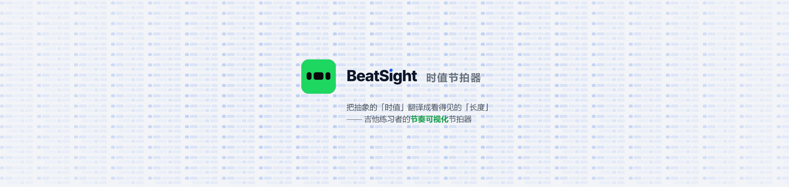
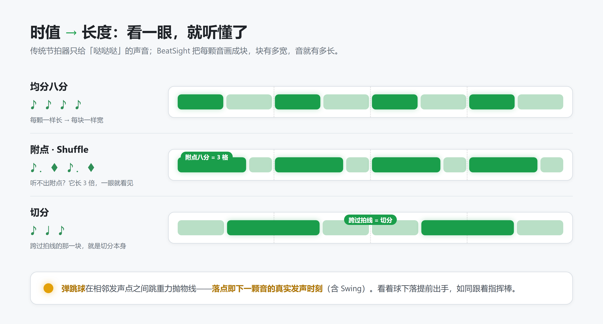

<p align="center">
  <picture>
    <source media="(prefers-color-scheme: dark)" srcset="docs/assets/banner-dark.png">
    
  </picture>
</p>

<p align="center">
  <a href="LICENSE"></a>
  <a href="https://github.com/chj0124/beatsight/actions"></a>
  <a href="https://beatsight.chenhuajian1995.workers.dev/"></a>
  <a href="https://beatsight.app.workbuddy.host/"></a>
</p>

<p align="center">
  <b>吉他练习与弹唱的节奏可视化工具。</b><br>
  传统节拍器只给「哒哒哒」；BeatSight 把每个音符画成块——块有多宽，音就有多长。
</p>

<p align="center">
  <a href="#这是什么">这是什么</a> ·
  <a href="#看一眼">看一眼</a> ·
  <a href="#它是怎么工作的">它是怎么工作的</a> ·
  <a href="#功能一览">功能一览</a> ·
  <a href="#快速开始">快速开始</a> ·
  <a href="#开发者">开发者</a>
</p>

## 这是什么

BeatSight 是辅助吉他练习与弹唱的节奏可视化工具。练习弹唱时，歌词、和弦与旋律可以随谱面一起呈现，帮助你找到弹奏与演唱的配合点。练琴时最劝退的不是「跟不上」，而是**听不出**——附点到底长了多少？切分到底错在哪？光靠耳朵，很多人练很久也建立不起这个直觉。

BeatSight 的做法是把节奏**画出来**：每个音符是一个块，块宽与时值严格成正比；一只弹跳球在发声点之间跳抛物线，落点即下一个音符的真实时刻。眼睛先学会，耳朵就跟上了。

工程形态上它走另一个极端：**单文件、零运行时依赖、无构建**——全部功能在 `index.html` 一个文件里，双击即开，不装任何东西、不发任何请求；数据只存本机 `localStorage`，无账号、无上传；在线版可安装为 PWA，装完断网照常练习。

## 看一眼

<table>
  <tr>
    <td width="50%"><b>主界面 · 播放中</b>（附点布鲁斯）</td>
    <td width="50%"><b>曲式模式</b> ·《在他乡》整首连播中</td>
  </tr>
  <tr>
    <td><picture><source media="(prefers-color-scheme: dark)" srcset="docs/assets/shot-main-dark.png?v=20261107"></picture></td>
    <td></td>
  </tr>
  <tr>
    <td><b>曲式编排</b> · 歌曲地图 + 段落卡片 + 歌词对齐</td>
    <td><b>自定义编辑器</b> · 音符块库画自己的节奏型</td>
  </tr>
  <tr>
    <td></td>
    <td></td>
  </tr>
</table>

<p align="center">
  <br>
  <sub>手机浏览器直开，窄屏自动分片。截图均为真实运行中的页面（应用内「经典」主题）。</sub>
</p>

## 它是怎么工作的

<picture>
  <source media="(prefers-color-scheme: dark)" srcset="docs/assets/how-dark.png">
  
</picture>

- **弹跳球预判落点**：球在相邻发声点之间跳重力抛物线，落点即下一个音符的真实发声时刻（含 Swing）——看着球下落提前出手，如同跟指挥棒；跳距与时值成正比，静音小节照跳、休止符长跳跨过
- **同屏 N 行窗口**（分页 2–4 行可调）：曲式模式下是歌曲正在弹的连续 N 个小节，页末行原地替换为「下一小节：型名」预告行，扫弦可提前备型；型短于 N 绕回铺满，型长于 N 按 N 行翻页。连续滚动另有 1 / 3 行档，单行使用 1.5 倍谱面高度
- **蓝牙/设备延迟补偿**：把声音按设备延迟统一提前（0–500ms），滑杆手动微调，按设备存多套配置——戴蓝牙耳机练也能对齐

## 功能一览

当前 `v3.59.3` · [变更记录](CHANGELOG.md) · 完整操作见应用内「使用方法」。

- **时值可视化**：音符块宽度即时值，弹跳球预告落点；支持分页、连续滚动和窄屏分片。
- **节奏库与编辑器**：内置节奏、拍数与细分组合、自定义编辑；支持扫弦、逐弦拨弦、休止和重拍设置。
- **歌曲与编排**：两首示例曲、段落编排与范围循环；支持歌词、和弦与简谱／音名标注。
- **练习工具**：速度与 Swing、预备与静音、变速和听辨训练，以及音色、音量和设备延迟补偿。
- **本地与平台**：单文件直开、本地存档与导入导出；支持 PWA 离线、双主题和后台保活。

## 快速开始

| 方式 | 入口 | 什么时候会更新 |
|---|---|---|
| **在线 ①（Cloudflare，自动）** | https://beatsight.chenhuajian1995.workers.dev/ | 仓库接 Git，推 `main` 即自动构建部署，**线上始终是最新代码** |
| **在线 ②（WorkBuddy，手动）** | https://beatsight.app.workbuddy.host/ | 仅在你用 WorkBuddy 打开项目并发布时才更新，**滞后是常态**，别拿它判断「线上是不是最新版」 |
| **本地** | 双击 `index.html` | 与仓库同版；任意现代浏览器，手机浏览器同样适用 |

- 两条在线渠道都支持 PWA 安装到桌面 / 主屏幕。
- 首次发声需先点击页面任意位置（浏览器音频策略）。空格键开始 / 停止。
- ⚠️ **两种用法的数据不互通**：`file://` 与 `https://` 是不同 origin，`localStorage` 不共享。在本地攒的预设，打开在线版会看到空的——迁移请用「导出预设 / 导入预设」，或「导出全部数据 / 导入全部数据」。

## 开发者

Node ≥ 22，**核心闸门零安装**——不装任何东西也能跑完整套自验：

```bash
node tools/check-all.js          # 共 24 步：语法 → 架构约束 → 装配完整性 → 零依赖 lint → 版本一致性 → 文档一致性 → _headers 结构 → 过期副本检测 → 远端漂移核对 → DOM 节点账本 → 测试桩能力对账 → 资源体积预算 → CSS 孤儿扫描 → 设计令牌 → ESLint（可选）→ 类型检查（可选）→ DOM 引用 → 无障碍 → 反向验证入口回归 → 双渠道对账回归 → 浏览器冒烟（环境可选）→ 全量测试 → 死循环看门狗 → 行覆盖率
node tools/check-all.js --quick  # 跳过 T21 全量组合扫描（改代码时用）
```

- 24 步里有 4 步可能标 ⊘（**未执行**，不等于通过）：ESLint / 类型检查缺 `node_modules`、浏览器冒烟缺本机浏览器、远端漂移核对缺 `gh`。它们绝不会因为「没装开发依赖」堵住部署；`npm install` 后自动启用。耗时刻意不写进文档（`tools/check-docs.js` 强制），命令末尾会自己打印「全部通过 · 实跑 N/M 项 · 用时 Xs」。
- CI 在 `.github/workflows/ci.yml`：push 与 PR 都跑 `npm run ci`，并另开一个 job 跑真实浏览器冒烟——它是对所有分支生效的**补位**，Cloudflare 那条路只拦推到 main 的那次构建。
- 发版纪律：`index.html` 的 `const VERSION` 是唯一真相源，**每次发版必 bump**（`package.json` / `package-lock.json` / `CHANGELOG.md` 首条由 `check-version.js` 强制一致）；发布前跑一次全量 `node tools/check-all.js`；视觉/手感类改动另需人眼验收，冒烟看不出「好不好用」。
- `npm install` 会自动安装提交与推送钩子；也可手动运行 `node tools/install-hooks.js`。
- 发布前：`npm run publish:check` 执行全量严格自验、重建 `dist/` 并核对本地产物。WorkBuddy 手动发布后跑 `npm run publish:verify`，要求 Cloudflare 与 WorkBuddy 实际版本都与源码一致；单独运行 `node tools/check-deploy-parity.js` 仍只读报告，不因线上尚未更新判红。

开发约定见 [AGENTS.md](AGENTS.md)；架构与自验详见 [docs/DEVELOPMENT.md](docs/DEVELOPMENT.md)，更多文档见 [docs/README.md](docs/README.md)。

## 设计稿

视觉系统：深色沉浸练习舱（`#121212` 底 + `#1ED760` 功能绿 + 全胶囊控件），另有浅色「日间」主题；详见 `docs/DEVELOPMENT.md` 第 4 节。README 顶图与信息图由同一套视觉系统生成（深浅双版，跟随系统主题切换）。
交互设计稿（3 屏：桌面主界面 / 移动端 / 自定义编辑器，内部 Ardot 画布）：`https://ardot.tencent.com/file/721823967024298`

## 技术栈

原生 HTML/CSS/JS 单文件，Web Audio API 时钟调度，localStorage 持久化，无构建步骤、无运行时依赖。

## License

MIT
